# GoTravel — Travel Agency Management System

Web Technology semester project, built with the **MERN stack** (MongoDB, Express, React, Node.js).

**Group members**
- Zainab Asif (FA22-BCS-068)
- Hafsa Khurram (FA22-BCS-058)

GoTravel automates the work of a travel agency: customers browse and book tour packages, travel agents manage packages, bookings and payments, and administrators manage users and see business analytics.

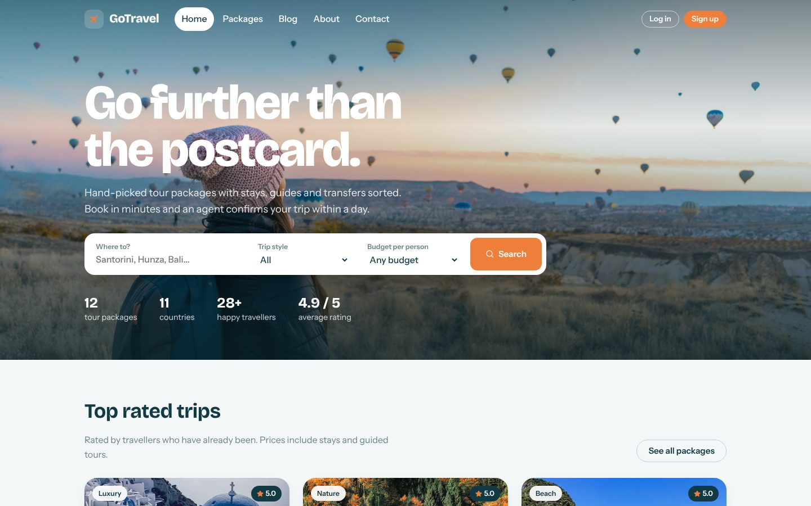

---

## Screenshots

### Customer side

| Homepage | Tour packages |
|---|---|
|  | 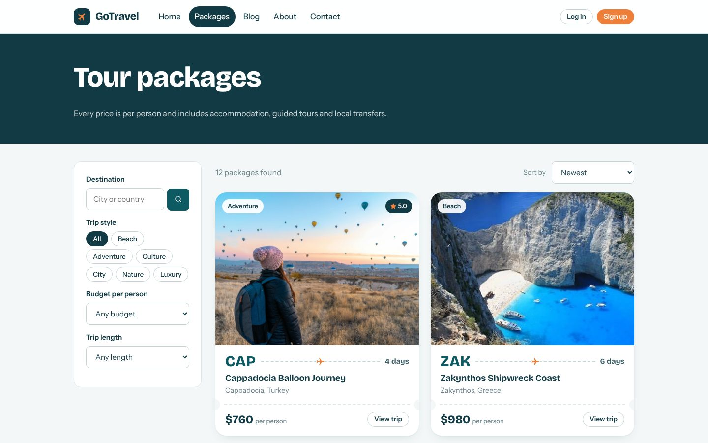 |

| Package detail and booking | Login |
|---|---|
| 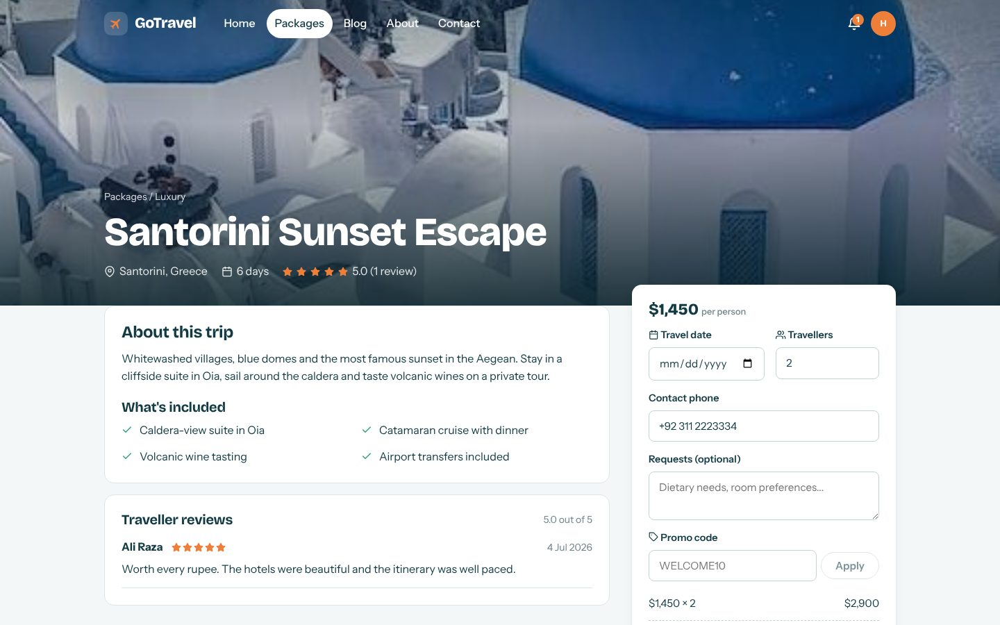 | 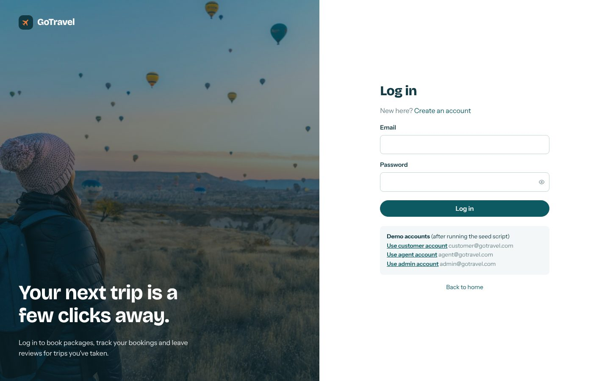 |

| My bookings | Invoice |
|---|---|
| 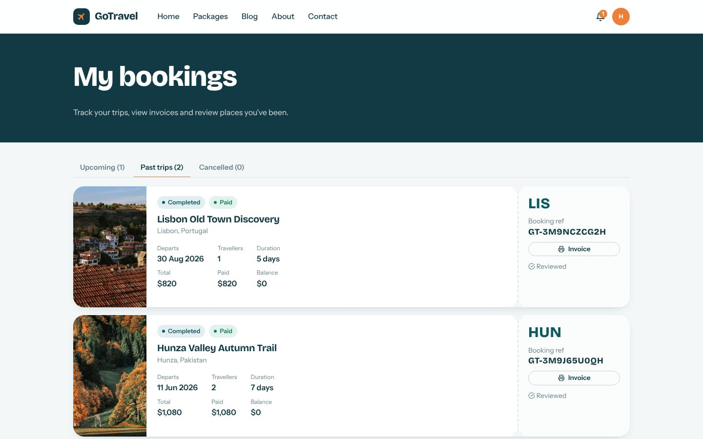 | 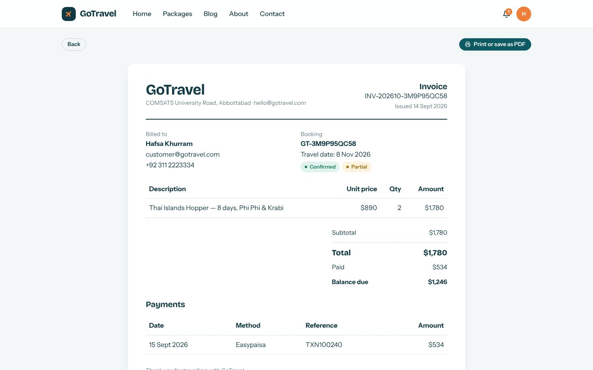 |

### Agent and admin portal

| Admin analytics dashboard | Booking management |
|---|---|
| 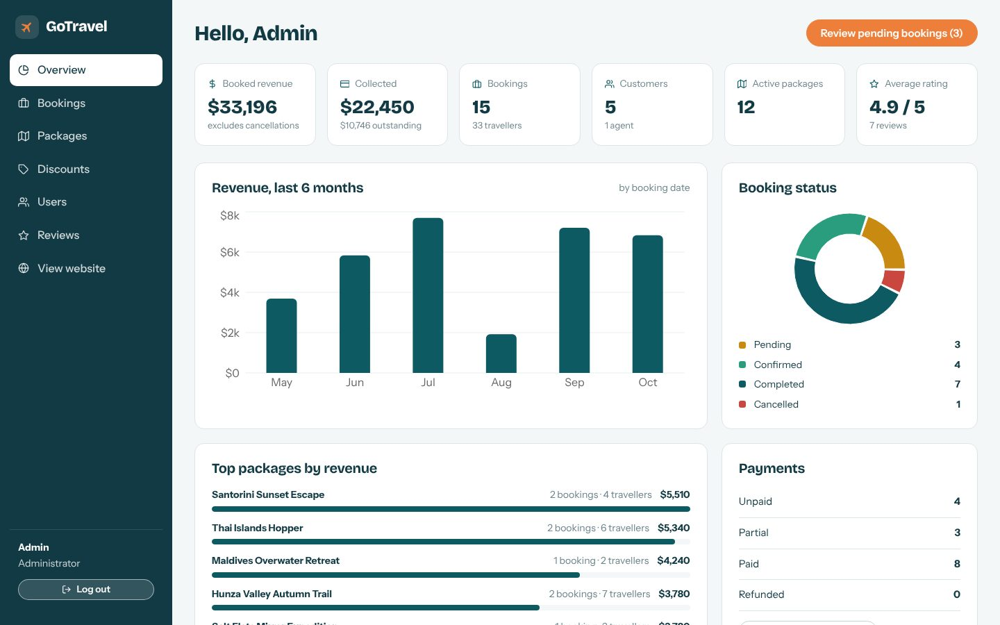 | 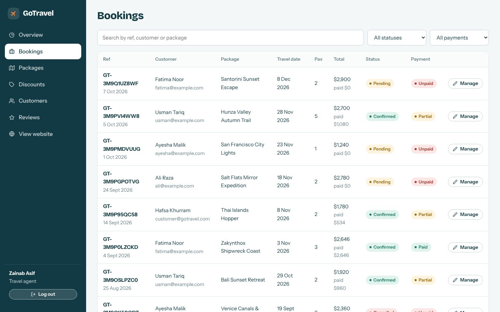 |

| Manage a booking (confirm, modify, payments, discount) | Package management |
|---|---|
| 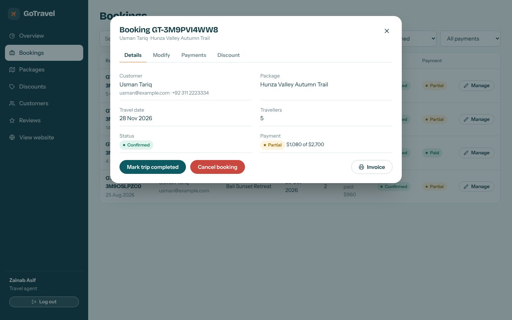 | 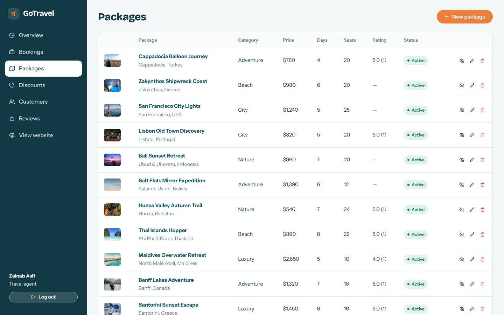 |

| User management | Mobile view |
|---|---|
| 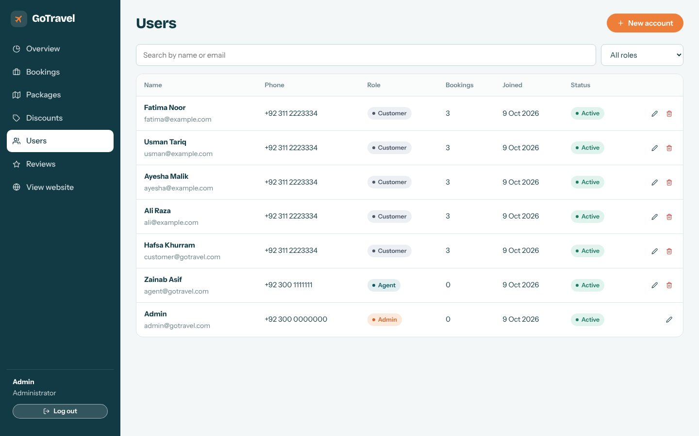 | 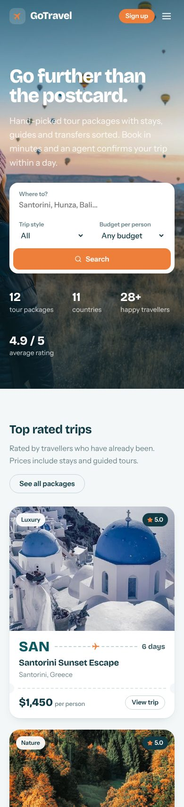 |

<details>
<summary>Full homepage</summary>

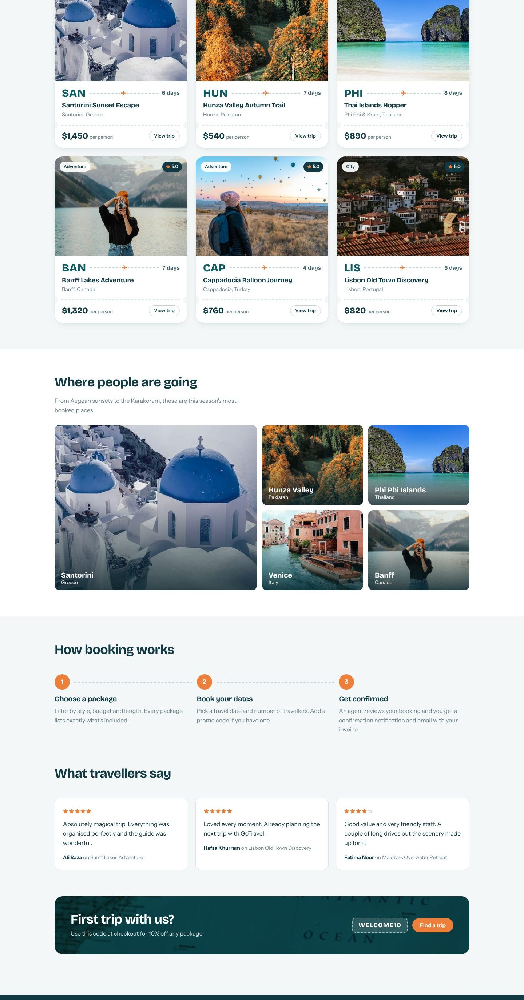

</details>

---

## Features (mapped to the proposal)

### 1. User portal (customers)
- **Registration / login** with encrypted passwords (bcrypt) and JWT sessions; profile and password editing
- **Package search and booking**: search by destination, filter by trip style, budget and length, sort by price or rating
- Package detail page with highlights, reviews, live price summary and **promo codes**
- **Booking confirmation**: in-app notifications (bell icon) and email (when SMTP is configured) when a booking is received, confirmed, updated, paid, cancelled or completed
- **My bookings** shown as boarding passes, with status, payment balance, cancel option and printable **invoice**

### 2. Travel agent portal (`/dashboard`)
- **Package management**: create, edit, hide/show and delete packages (packages with bookings are archived, not deleted)
- **Booking management**: view, search and filter all bookings; confirm, modify (travellers, date, notes), complete or cancel; seat availability is checked per departure date
- **Payment handling**: record full or partial payments (cash, card, bank transfer, Easypaisa, JazzCash), mark refunds, **apply discounts**, and **generate invoices**
- **Discount codes**: create, enable/disable and delete promo codes
- Customer list with editing

### 3. Admin portal (`/dashboard`, admin account)
- **User management**: create customers, agents and admins; change roles; activate/deactivate; delete accounts
- **Package overview**: full control over every package
- **Analytics**: booked vs collected revenue, outstanding balance, revenue for the last 6 months, booking status breakdown, payment status, top packages, average rating
- Review moderation

### 4. Feedback and rating system
- Customers rate (1–5 stars) and review each package they've travelled on (one review per booking)
- Package ratings update automatically and appear on package cards, detail pages and the homepage

---

## Tech stack

| Layer    | Technology |
|----------|-----------|
| Frontend | React 19, React Router 7, Vite, Recharts, React Icons, plain CSS |
| Backend  | Node.js, Express 4, JWT, bcryptjs, Nodemailer |
| Database | MongoDB with Mongoose 8 |

## Project structure

```
Web-Technology/
├── client/                 React frontend (Vite)
│   ├── public/images/      Optimised travel photos
│   └── src/
│       ├── components/     Navbar, Footer, PackageCard, guards, shared UI
│       ├── context/        Auth and toast state
│       ├── pages/          Public pages, customer account pages
│       │   └── dashboard/  Agent / admin portal
│       └── styles/         Design system (index.css)
└── server/                 Express + MongoDB API
    └── src/
        ├── models/         User, Package, Booking, Feedback, Coupon, Notification
        ├── routes/         auth, packages, bookings, feedback, users, analytics...
        ├── middleware/     JWT auth and role checks
        └── seed.js         Demo data
```

---

## How to run

### What you need (install once)
1. **Node.js 18 or newer** — https://nodejs.org (LTS version)
2. **Git** — https://git-scm.com
3. **MongoDB** — either
   - **MongoDB Community Server** (installs locally, includes Compass) — https://www.mongodb.com/try/download/community, or
   - a free **MongoDB Atlas** cluster in the cloud — https://www.mongodb.com/atlas

### Steps
```bash
# 1. Download the project
git clone https://github.com/Hafsa-Khurram/Web-Technology.git
cd Web-Technology

# 2. Install all packages (root, server and client)
npm run install-all

# 3. Create the server settings file
copy server\.env.example server\.env      # Windows (Command Prompt)
cp server/.env.example server/.env        # macOS / Linux / Git Bash
#    Using Atlas? Open server/.env and set MONGO_URI to your Atlas connection string.

# 4. Load demo data (clears the gotravel database)
npm run seed

# 5. Start the API (port 5000) and the React app (port 5173) together
npm run dev
```

Open **http://localhost:5173** in your browser. Stop the app with `Ctrl + C`.

### Getting the latest changes later
```bash
cd Web-Technology
git pull
npm run install-all   # only needed if packages changed
npm run dev
```

### Common problems
| Problem | Fix |
|---|---|
| `Could not connect to MongoDB` | Start the MongoDB service (Windows: Services → MongoDB Server → Start) or check `MONGO_URI` in `server/.env` |
| `EADDRINUSE: address already in use :5000` | Another program is using port 5000. Close it, or change `PORT` in `server/.env` and the proxy port in `client/vite.config.js` |
| Packages page is empty | Run `npm run seed` |
| `npm` is not recognised | Reinstall Node.js and restart the terminal |

### Demo accounts

| Role     | Email                   | Password    |
|----------|-------------------------|-------------|
| Customer | customer@gotravel.com   | customer123 |
| Agent    | agent@gotravel.com      | agent123    |
| Admin    | admin@gotravel.com      | admin123    |

Promo codes: `WELCOME10` (10% off), `SUMMER20` (20% off).

### Production build
```bash
npm run build   # builds client/dist
npm start       # Express serves the API and the built React app on http://localhost:5000
```

### Emails
Booking emails are printed in the server console by default. To send real emails, fill in the `SMTP_*` values in `server/.env` (for Gmail use an App Password).

---

## API overview

| Method | Endpoint | Access |
|--------|----------|--------|
| POST | `/api/auth/register`, `/api/auth/login` | Public |
| GET / PATCH | `/api/auth/me` | Logged in |
| GET | `/api/packages`, `/api/packages/:id` | Public |
| POST / PUT / DELETE | `/api/packages/:id` | Agent, Admin |
| POST | `/api/bookings` | Customer |
| GET | `/api/bookings/mine` | Customer |
| POST | `/api/bookings/:id/cancel` | Owner |
| GET / PATCH | `/api/bookings`, `/api/bookings/:id` | Agent, Admin |
| POST | `/api/bookings/:id/payments`, `/api/bookings/:id/refund` | Agent, Admin |
| PATCH | `/api/bookings/:id/discount` | Agent, Admin |
| POST | `/api/feedback` | Customer (after trip) |
| GET / POST / PATCH / DELETE | `/api/users` | Admin (agents: customers only) |
| GET / POST / PATCH / DELETE | `/api/coupons` | Agent, Admin |
| GET | `/api/analytics` | Agent, Admin |
| GET | `/api/notifications` | Logged in |
